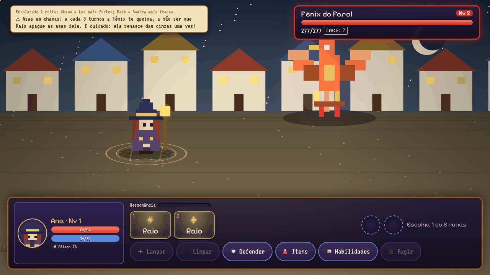
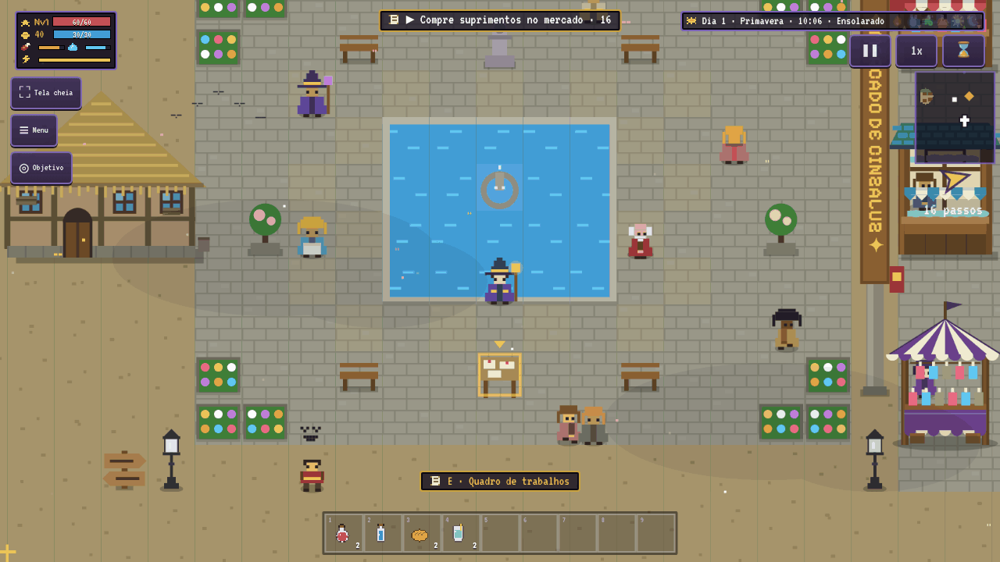
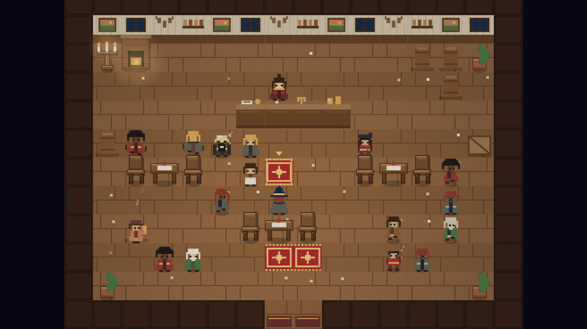
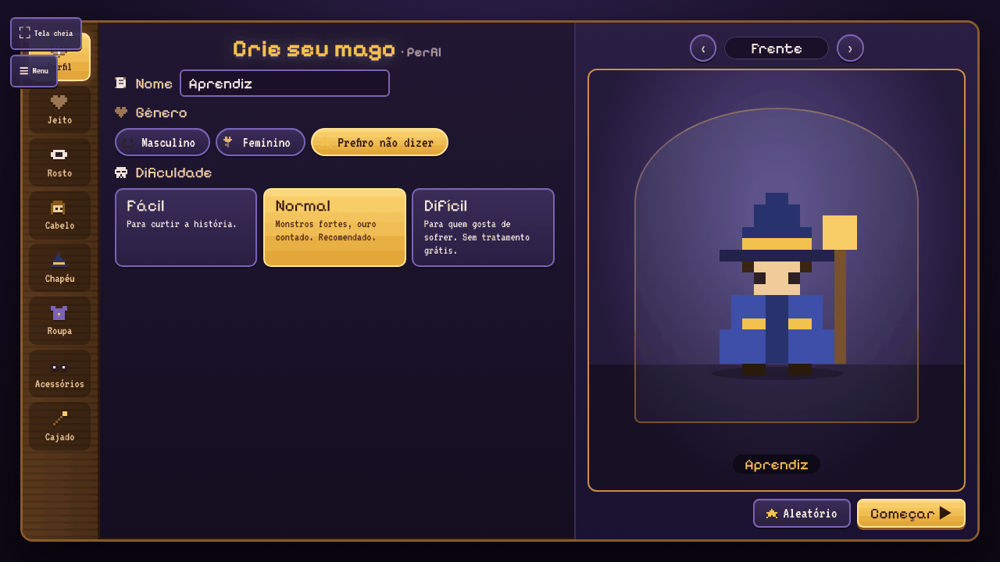

# Ecos do Arcano — A Magia Perdida

<div align="center">


</div>

<div align="center">

[](https://git.io/typing-svg)

</div>

<br>

<div align="center">


<br><br>

### 🎮 [Jogar agora no navegador](https://b3ery.github.io/EcosDoArconos/)

<br>


</div>

<br>

---

## 👥 Nossa Equipe

<div align="center">

<sub>Universidade São Judas Tadeu · 2026</sub>

<br><br>

<table>
  <tr>
    <td align="center" width="20%">
      <a href="https://github.com/atr3ssa">
        <br>
        <sub><b>Andressa Rabêlo</b></sub>
      </a><br>
      <sub>RA: 823213904</sub>
    </td>
    <td align="center" width="20%">
      <a href="https://github.com/Marzocca99">
        <br>
        <sub><b>Lucas Marzocca</b></sub>
      </a><br>
      <sub>RA: 823116813</sub>
    </td>
    <td align="center" width="20%">
      <a href="https://github.com/Elmarquitoos">
        <br>
        <sub><b>Marcos V. Santos</b></sub>
      </a><br>
      <sub>RA: 82327399</sub>
    </td>
    <td align="center" width="20%">
      <a href="https://github.com/matheushfg">
        <br>
        <sub><b>Matheus H. F.</b></sub>
      </a><br>
      <sub>RA: 823141914</sub>
    </td>
    <td align="center" width="20%">
      <a href="https://github.com/b3ery">
        <br>
        <sub><b>Mylena Soares</b></sub>
      </a><br>
      <sub>RA: 824144075</sub>
    </td>
  </tr>
</table>

</div>

<br>

---

## 🌌 Sobre

**Ecos do Arcano** é um RPG em pixel art que roda no navegador, no computador e no celular. Há trezentos anos as seis runas foram aprisionadas e o mundo esqueceu a magia. Você é um aprendiz que ainda carrega um eco de uma delas.

| ⚔️ Modo História | 🏡 Simulador de Vida |
|:---|:---|
| Liberte os Guardiões das seis runas, enfrente o Silenciador e escolha entre herói e vilão. | Uma vida inteira em Cinzaluz: trabalho, comércio, amor, família, política e crime. |

<div align="center">

| | |
|:---:|:---:|
| <br><sub>Batalha contra a Fênix do Farol</sub> | <br><sub>A praça de Cinzaluz com a turma</sub> |
| <br><sub>A Taverna Javali Dourado</sub> | <br><sub>Crie o seu personagem</sub> |

</div>

---

## 🚀 Como jogar

**Online:** [b3ery.github.io/EcosDoArconos](https://b3ery.github.io/EcosDoArconos/) · **No computador:** baixe o repositório e abra o `index.html`.

```
Setas / WASD   Mover            I     Inventário
E / Espaço     Interagir        1–9   Barra de itens
M              Mapa             Esc   Menu (opções, tela cheia, tutoriais)
```

No celular: joystick na metade esquerda da tela e botões de ação. Na primeira vez em cada coisa nova, um tutorial curto explica como funciona.

---

## 🛠️ Para quem desenvolve

HTML5, CSS3 e JavaScript puro, sem dependências. Tudo é desenhado no `<canvas>` e a música é gerada com o Web Audio API.

- `js/` está dividido em `nucleo`, `mundo`, `pessoas`, `interface`, `historia` e `vida`. A ordem dos scripts fica no `index.html`.
- `npm run check` confere a sintaxe; `npm test` abre o jogo e testa os dois modos.

<div align="center">

<br>


</div>
