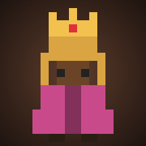
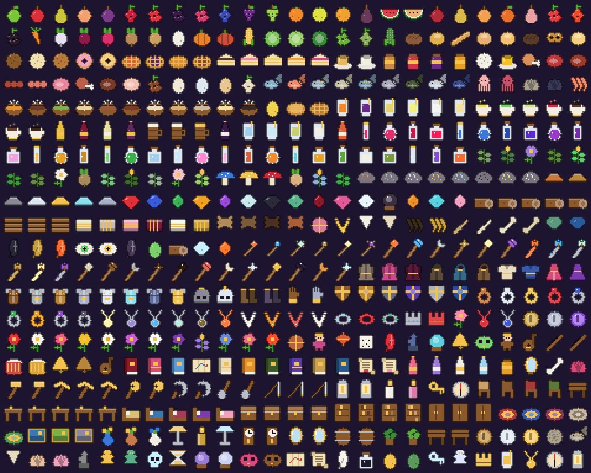

# Ecos do Arcano — A Magia Perdida

<div align="center">


</div>

<div align="center">

[](https://git.io/typing-svg)

</div>

<br>

<div align="center">


<br><br>

### 🎮 [Jogar agora no navegador](https://b3ery.github.io/EcosDoArconos/)

</div>

<br>

---

## 👥 Nossa Equipe

<div align="center">

<sub>Universidade São Judas Tadeu · 2026</sub>

<br><br>

<table>
  <tr>
    <td align="center" width="20%">
      <a href="https://github.com/atr3ssa">
        <br>
        <sub><b>Andressa Rabêlo</b></sub>
      </a><br>
      <sub>RA: 823213904</sub>
    </td>
    <td align="center" width="20%">
      <a href="https://github.com/Marzocca99">
        <br>
        <sub><b>Lucas Marzocca</b></sub>
      </a><br>
      <sub>RA: 823116813</sub>
    </td>
    <td align="center" width="20%">
      <a href="https://github.com/Elmarquitoos">
        <br>
        <sub><b>Marcos V. Santos</b></sub>
      </a><br>
      <sub>RA: 82327399</sub>
    </td>
    <td align="center" width="20%">
      <a href="https://github.com/matheushfg">
        <br>
        <sub><b>Matheus H. F.</b></sub>
      </a><br>
      <sub>RA: 823141914</sub>
    </td>
    <td align="center" width="20%">
      <a href="https://github.com/b3ery">
        <br>
        <sub><b>Mylena Soares</b></sub>
      </a><br>
      <sub>RA: 824144075</sub>
    </td>
  </tr>
</table>

</div>

<br>

---

## 🌌 Sobre o Projeto

> **Ecos do Arcano** é um **RPG em pixel art** que roda direto no navegador, no computador e no celular. Há trezentos anos, o mago Vesper aprisionou as runas para "proteger" a magia e o mundo mergulhou no **Grande Silêncio**. Você é um aprendiz que ainda ouve o eco das runas: combine elementos, liberte os Guardiões, descubra o segredo dos irmãos e devolva a Canção Arcana ao mundo. ✦💜

<br>

<div align="center">

```
╔══════════════════════════════════════════════════════════════════════╗
║  🏘️ Cinzaluz  →  🌲 Bosque (Ent)  →  🌫️ Pântano (Serpente)          ║
║        ↓                                         ↓                   ║
║  ✦ Epílogo  ←  🗼 Torre (Silenciador)  ←  🏔️ Picos (Grifo)          ║
╚══════════════════════════════════════════════════════════════════════╝
```

</div>

<br>

---

## 📸 Capturas de Tela

<div align="center">

| | |
|:---:|:---:|
| <br><sub>Tela inicial</sub> | <br><sub>Praça de Cinzaluz</sub> |
| <br><sub>Batalha no Bosque Murmurante</sub> | <br><sub>Cerimônia de casamento</sub> |
| <br><sub>Porto Brisamar</sub> | <br><sub>Pedravale</sub> |
| <br><sub>Protesto dos Iluministas: tomates na Rainha</sub> | <br><sub>Lucas Marzocca fugindo de mais um marido com faca</sub> |
| <br><sub>Os moradores conversam entre si</sub> | <br><sub>Personalidade e orientação no criador</sub> |
| <br><sub>Casa pintada com os móveis novos</sub> | <br><sub>Decorar: Móveis, Pintar e Reformar</sub> |
| <br><sub>Fachada pintada e segundo andar com floreira</sub> | <br><sub>No celular (deitado), andando com o dedo</sub> |

</div>

<br>

---

## 🎓 Destaque: Professor Bruno Honda

<div align="center">


**Professor Bruno Honda** · Historiador de runas · Praça de Cinzaluz, ao lado da fonte

</div>

Faz quarenta anos que estuda as ruínas da **Academia Arcana** e é o único que ainda lê a escrita rúnica antiga em que **Vesper** escreveu o diário. Cada página perdida que o aprendiz traz, ele decifra e conta o que ela revela, dando **XP** pelo estudo. Com 3 páginas, ele entrega os **Óculos do Professor Honda** (+12% de dano mágico e +15 MP). Com as 5, ele explica como libertar Vesper no final. Fora isso, dá dicas sobre os níveis dos monstros e sobre como fugir do Imposto Real.

<br>

---

## 🍻 A Turma de Cinzaluz: os Alcoólatras Anônimos

Os criadores do jogo viraram personagens importantes da história, com seus parceiros. Cada um tem **casa, trabalho e rotina**: sai de casa de manhã, vai para o seu estabelecimento, anda pela vila e volta à noite. Bata na porta da casa deles para visitar.

- Os cinco se encontram na **fonte da praça** em dia de festival à noite e a cada 3 dias no fim da tarde.
- **Mylena, Andressa e Júlia** tomam café na frente do **Ateliê** todo dia à tarde (14h30 às 17h).
- **Eles trabalham lá dentro:** Andressa e o Pedro Poeta na **Biblioteca**, a Princesa Mylena no **Ateliê**, a Júlia na **Clínica**, Marcos, Julia, Pedro Max e Malu no **Castelo**, e à noite Lucas, Luca e o Poeta na **Taverna**. Entre nos prédios para falar com eles.
- **Bairro das Flores:** a vila cresceu para o sul. As casas da turma ficam lá, com espaço, ruas com lampiões e casas novas à venda.
- **Família real completa:** Rainha Aurélia, Príncipe Pedro Max, Princesa Mylena, Duque Matheus e Duquesa Malu desfilam juntos.
- O **Lucas** dorme até as 10h, passa a tarde na praça e a noite na porta da taverna.
- **Os Alcoólatras Anônimos** (Lucas, Matheus, Marcos, Andressa, Mylena e Júlia) têm **reunião semanal na Taverna Javali Dourado** (a cada 7 dias, das 19h às 23h). Sente com o grupo, pague uma rodada, leia a ata ou desafie o Marcos na queda de braço.

<div align="center">

| | | | | |
|:---:|:---:|:---:|:---:|:---:|
| <br><b>Lucas Marzocca</b><br><sub>O rolezeiro e o único solteiro. Só conversa depois de ganhar um hidromel; mora no Quartinho ao lado da taverna.</sub> | <br><b>Matheus</b><br><sub>O fazendeiro, melhor amigo do Lucas. Trabalha na plantação e mora no Sítio.</sub> | <br><b>General Marcos</b><br><sub>Treina ao amanhecer e guarda o portão do castelo. Treina você (+vida máxima).</sub> | <br><b>Andressa</b><br><sub>Dona da maior rede de bibliotecas. Misteriosa, vende informações de segurança. Trabalha na Biblioteca.</sub> | <br><b>Mylena</b><br><sub>Artista do Ateliê de quadros e móveis (a loja abre das 7h às 17h). Engraçada e amada por todos.</sub> |
| | <br><b>Duquesa Malu</b><br><sub>Esposa do Duque Matheus</sub> | <br><b>Princesa Julia das Marés</b><br><sub>Esposa do Marcos</sub> | <br><b>Pedro, o Poeta</b><br><sub>Marido da Andressa</sub> | <br><b>Príncipe Pedro Max</b><br><sub>Filho da Rainha, marido da Princesa Mylena</sub> |

| | |
|:---:|:---:|
| <br><b>Júlia Oliveira</b><br><sub>Homenagem: veterinária e dona dos bichos. Atende na <b>Clínica Veterinária</b> (consulta do mascote e adoção), mora na Mansão Oliveira. Super rica e feliz.</sub> | <br><b>Rei Vini do Sul</b><br><sub>Marido da Júlia. Visita Cinzaluz nos festivais e no fim de semana.</sub> |

</div>

| | |
|:---:|:---:|
| <br><b>Luca, o Maluco</b><br><sub>Careca, barbudo e fora da caixinha: conversa com quem está jogando (quebra a quarta parede). Às vezes aparece com o grupão.</sub> | <b>Os Iluministas</b><br><sub>Luca e Lucas Marzocca são contra a monarquia. Entre para o grupo pelo menu deles e convença os moradores (Interações → Reino → Convencer a ser iluminista). Cinco convertidos dão uma conquista. A Rainha não gosta nada disso.</sub> |

> **Na história:** se você for amigo dos cinco, a turma aparece na batalha contra o Silenciador e luta com você (+25% de dano). Só o Lucas pode ser namorado: o resto da turma é casado.

<br>

---

## 🧙 Personagens Principais

<div align="center">

| | | | |
|:---:|:---:|:---:|:---:|
| <br><b>Arquimaga Odelia</b><br><sub>Mentora do aprendiz e irmã de Vesper · Cinzaluz</sub> | <br><b>Instrutor Kael</b><br><sub>Ensina a lutar com runas · Cinzaluz</sub> | <br><b>Bruno, o Alquimista</b><br><sub>Poções e remédios · Cinzaluz</sub> | <br><b>Rosa, a Quitandeira</b><br><sub>Comida e bebida · Cinzaluz</sub> |
| <br><b>Doran, o Artesão</b><br><sub>Cajados mágicos · Cinzaluz</sub> | <br><b>Curandeira Maíra</b><br><sub>Cura e cuidados · Cinzaluz</sub> | <br><b>Capitão Bento</b><br><sub>Velho marinheiro · Porto Brisamar</sub> | <br><b>Anciã Berta</b><br><sub>Conhece a história dos anões · Pedravale</sub> |
| <br><b>Druida Errante</b><br><sub>Dicas sobre o Ent · Bosque Murmurante</sub> | <br><b>Monge da Montanha</b><br><sub>Dicas sobre o Grifo · Picos Uivantes</sub> | <br><b>Professora Selene</b><br><sub>Antiga professora · Academia Arcana</sub> | <br><b>Espírito de um Aprendiz</b><br><sub>Dicas sobre o Silenciador · Torre do Silêncio</sub> |

</div>

> Cada morador tem tom de pele, penteado e roupa próprios. Só quem ainda guarda magia, a **Arquimaga Odelia** e a **Professora Selene**, usa chapéu pontudo e cajado brilhante.

<br>

---

## 👑 Família Real

<div align="center">

| | | | |
|:---:|:---:|:---:|:---:|
| <br><b>Rainha Aurélia</b><br><sub>Recebe aventureiros no Castelo de Cinzaluz</sub> | <br><b>Príncipe Leon</b><br><sub>Acompanha a rainha na passeata</sub> | <br><b>Princesa Aurora</b><br><sub>Acompanha a rainha na passeata</sub> | <br><b>Guarda Real</b><br><sub>Guarda o portão do castelo e a passeata</sub> |

</div>

> A cada 5 dias, das 10h ao meio-dia, a família real faz uma **passeata** pela vila, contornando a fonte da praça.

<br>

---

## 👹 Chefes

<div align="center">

| Chefe | Nome | Onde | Nível | Dificuldade | Vida<br><sub>Fácil / Normal / Difícil</sub> | Ataque<br><sub>Fácil / Normal / Difícil</sub> | XP |
|:---:|:---|:---|:---:|:---:|:---:|:---:|:---:|
|  | **Ent Silenciado**<br><sub>Guardião</sub> | 🌲 Bosque Murmurante | **Nv 4+** | ★★☆☆☆ | 158 / 221 / 316 | 12 / 16 / 21 | 66 |
|  | **Serpente de Névoa**<br><sub>Guardião</sub> | 🌫️ Pântano das Brumas | **Nv 6+** | ★★★☆☆ | 186 / 260 / 372 | 14 / 19 / 24 | 94 |
|  | **Grifo de Pedra**<br><sub>Guardião</sub> | 🏔️ Picos Uivantes | **Nv 8+** | ★★★☆☆ | 239 / 335 / 478 | 18 / 24 / 31 | 120 |
|  | **Basilisco de Cristal**<br><sub>Guardião</sub> | ⛏️ Mina de Cristal (Pedravale) | **Nv 9+** | ★★★★☆ | 271 / 379 / 542 | 18 / 24 / 31 | 150 |
|  | **Leviatã do Cais**<br><sub>Guardião</sub> | ⚓ Píer do Porto Brisamar | **Nv 10+** | ★★★★☆ | 296 / 414 / 592 | 19 / 26 / 33 | 168 |
|  | **Espírito do Vitral**<br><sub>Chefe secreto</sub> | ⛪ Templo da Luz (opcional) | **Nv 8+** | ★★★★☆ | 265 / 371 / 530 | 18 / 24 / 31 | 156 |
|  | **Diretor Espectral**<br><sub>Chefe da masmorra</sub> | 📚 Academia Arcana | **Nv 10+** | ★★★★☆ | 328 / 459 / 656 | 19 / 26 / 33 | 180 |
|  | **O Silenciador**<br><sub>Chefe final</sub> | 🗼 Torre do Silêncio | **Nv 12+** | ★★★★★ | 612 / 857 / 1224 | 21 / 28 / 35 | — |

</div>

> Todo monstro tem **nível**, que aparece na batalha. O número da tabela é o nível mínimo do chefe: se o aprendiz treinar demais, o chefe sobe junto (fica um nível abaixo do jogador). Vida e ataque estão no nível mínimo. As fraquezas dos Guardiões mudam conforme a runa escolhida no início.

<br>

---

## 📜 A História — O Segredo dos Irmãos

| Ato | O que acontece |
|:---:|:---|
| **I** | O aprendiz desperta em **Cinzaluz** ouvindo o eco de uma runa. A Arquimaga **Odelia** o guia. |
| **II** | Os **Guardiões** (Ent, Serpente e Grifo) guardam as runas aprisionadas. Cada um libertado devolve um elemento. |
| **II·a** | **O Farol que Lembra** (Porto Brisamar): o Capitão Bento conta que a névoa veio do mar. Aceso à noite, o farol mostra Odelia e Vesper crianças, há trezentos anos. |
| **II·b** | **A Forja do Irmão** (Pedravale): a Anciã Berta revela o molde do cajado que Vesper encomendou aos anões. Um Fragmento Arcano da mina reabre o molde e mostra a inscrição dele. |
| **II·c** | **Os Guardiões perdidos**: o **Basilisco de Cristal** dorme no fundo da Mina de Cristal e o **Leviatã do Cais** na ponta do píer do Porto. Cada um guarda uma das runas que faltam. |
| **III** | Páginas do **diário de Vesper**, decifradas pelo **Professor Bruno Honda**, revelam quem ele era antes de se perder no Silêncio. |
| **IV** | Na **Torre do Silêncio**, um eco do passado mostra a última discussão dos irmãos. |
| **V** | No confronto final, o aprendiz lê as palavras do próprio Vesper e o liberta. **Epílogo:** os irmãos se reencontram. |

> Depois do final, dá para **continuar jogando** e completar as missões secundárias.

<br>

---

## 🔮 Sistema de Magia — Runas

São **6 runas** e **27 feitiços** formados por combinações de 1 ou 2 runas:

<div align="center">

| Runa | Elemento | Estilo |
|:---:|:---:|:---|
| 🔥 | **Chama** | Dano explosivo e queimadura |
| 💧 | **Maré** | Cura, controle e congelamento |
| 🌪️ | **Vento** | Golpes múltiplos e esquiva |
| ⛰️ | **Terra** | Escudos e enfraquecimento |
| ☀️ | **Luz** | Cura, cegueira e dano contra espíritos |
| 🌙 | **Sombra** | Roubo de vida e maldições |

</div>

- **Afinidade:** a runa escolhida no início dá +25% de dano e uma habilidade única.
- **Fraquezas e resistências:** acertar a fraqueza do inimigo causa quase o dobro de dano.
- **Domínio:** cada feitiço sobe até ★★★★★ com o uso (mais poder, menos mana).
- **Ressonância:** acertar fraquezas enche a barra da **Canção Arcana**, o golpe supremo.
- **Tomos da Academia:** ensinam 3 feitiços extras do seu elemento.

<br>

---

## 🏘️ O Mundo

<div align="center">

| Lugar | Tipo | Destaques |
|:---:|:---:|:---|
| 🏘️ **Cinzaluz** | Vila principal | Praça com fonte, mercado com 12 bancas, 20+ comércios com interior, castelo, templo, escola, taverna |
| ⚓ **Porto Brisamar** | Vila litorânea | Farol, peixaria, padaria, pedidos dos moradores |
| ⛏️ **Pedravale** | Vila na serra | Forja anã, mina, casa de chá, pedidos dos moradores |
| 🌲 **Bosque Murmurante** | Região | Elfos, rios e lagos, Guardião Ent |
| 🌫️ **Pântano das Brumas** | Região | Neblina, Guardião Serpente |
| 🏔️ **Picos Uivantes** | Região | Neve, Guardião Grifo |
| 📚 **Academia Arcana** | Masmorra | Tomos de feitiços, Diretor Espectral |
| 🗼 **Torre do Silêncio** | Masmorra final | O Silenciador |

</div>

<br>

---

## ⚙️ Funcionalidades

<div align="center">

| Feature | Descrição |
|:---:|:---|
| ⚔️ **Batalha por turnos** | Cenários por região, efeitos visuais por elemento, chefes com fases |
| 🌦️ **Clima e estações** | Primavera, verão, outono e inverno · sol, chuva, tempestade, neve e neblina |
| 🌗 **Dia e noite** | Moradores dormem, lojas fecham, monstros ficam mais fortes à noite |
| 🧑‍🤝‍🧑 **Vida na vila** | Moradores com rotina: compram, sentam, conversam, entram nas lojas |
| 💬 **Diálogos vivos** | Retrato animado, voz por personagem, falas que reagem ao que acontece |
| 💞 **Relacionamentos** | Amizade, namoro, casamento, filhos, abraços, beijos e gestos animados |
| 🏠 **Casa decorável** | 17 móveis para comprar e posicionar |
| 🐾 **Mascotes** | Cachorro, gato, coruja e coelho, cada um com um bônus |
| 🎉 **Festivais e festas** | Festival a cada 7 dias · festa na taverna toda noite · passeata da família real |
| 🎣 **Pesca** | Minijogo de reflexo em rios, lagos e no mar |
| 👊 **Brigas** | Arena com fôlego, golpes, bloqueio e esquiva · consequências na reputação |
| 🏫 **Escola** | Filhos estudam, tiram notas e se formam |
| 🍺 **Taverna** | 9 bebidas, concurso de bebida, queda de braço, karaokê |
| 🗣️ **Fofocas e reputação** | A vila comenta o que você faz e reage à sua fama |
| 🎵 **Música procedural** | Trilhas geradas pelo Web Audio API, sem arquivos de áudio |
| 📱 **Celular** | Joystick flutuante, botões na tela, tela cheia e qualidade automática |
| ⚙️ **Opções** | Volume, qualidade gráfica, zoom, vibração, dificuldade e controles |
| 📖 **Guia do Aprendiz** | Explica cada sistema do jogo em uma linha: onde fica e como usar |
| 🎓 **Escolas das vilas** | Aulas de navegação no Porto e de mineração em Pedravale |
| 💍 **Casamento e adoção** | Cerimônia animada no Templo e adoção de crianças |
| 👑 **Casar com a Rainha** | Corteje a Rainha Aurélia, vire Consorte Real: mesada de 50 ouro por dia e isenção do Imposto Real |
| 💘 **Romance** | Carinhos (beijo, mãos dadas, serenata, flores, beijo na testa, girar nos braços), encontros românticos e relacionamento aberto |
| 👨‍👩‍👧 **Filhos crescem** | Bebê → criança → adolescente → adulto. Filhos adultos namoram, casam (ou aceitam um casamento arranjado com dote) e dão netos |
| 🎨 **Ícones em pixel art** | Comida, bebida, roupas, equipamentos, fome, sede e clima |
| 💾 **Salvamento** | Progresso salvo automaticamente no navegador |

</div>

<br>

---

## 🎚️ Dificuldade

<div align="center">

| Modo | Monstros | Ouro e XP | Feitiços |
|:---:|:---|:---|:---|
| **Fácil** | Força normal | Normais | +20% de poder, −20% de mana |
| **Normal** | +40% vida, +35% ataque | Ouro ×0,85 · XP normal | Padrão |
| **Difícil** | +100% vida, +70% ataque | Ouro ×0,65 · XP ×0,85 | −5% de poder, +15% de mana |

</div>

> **Níveis dos monstros:** cada região tem uma faixa de níveis (Bosque 1–5, Pântano 4–8, Picos 6–10, Academia 8–12, Torre 9–14). Os monstros comuns aparecem perto do nível do aprendiz, dentro dessa faixa. Cada nível dá **+13% de vida, +10% de ataque e +10% de XP**. A defesa máxima dos equipamentos caiu de 75% para 60%.

## 🌦️ Clima e poder das runas (História)

Ao ar livre, cada clima deixa **duas runas mais fortes e uma ou duas mais fracas**. À noite a **Sombra** cresce e a **Luz** enfraquece; de dia é o contrário. Os botões das runas na batalha mostram **▲ verde** ou **▼ vermelho** com a porcentagem, e o topo da tela marca as runas do momento.

| Clima | Mais fortes | Mais fracas |
|:---|:---|:---|
| ☀️ Sol | Chama +15%, Luz +20% | Maré −15%, Sombra −20% |
| ☁️ Nublado | Vento +10%, Sombra +10% | Luz −10% |
| 🌧️ Chuva | Maré +20%, Terra +10% | Chama −20% |
| ⛈️ Tempestade | Vento +25%, Maré +10% | Chama −15%, Terra −10% |
| ❄️ Neve | Maré +15%, Terra +5% | Chama −15%, Vento −5% |
| 🌫️ Neblina | Sombra +20%, Vento +5% | Luz −15% |

## ⛈️ O clima no corpo e o fôlego

- **Calor** (sol forte do meio-dia): a sede cai bem mais rápido.
- **Encharcado** (chuva ou tempestade ao ar livre): a fome e o cansaço aumentam até você secar dentro de casa.
- **Congelando** (neve sem um manto reforçado): a vida cai aos poucos. Entre em casa ou vista um manto.
- **Tempestade de trovões:** raios caem de verdade. Um círculo amarelo pisca no chão antes do raio: saia de cima! Se acertar, tira 18% da vida.
- **Fôlego (modo História):** cada luta gasta fôlego (9, ou 22 contra Guardiões). Sem fôlego você não consegue lutar e precisa **voltar para dormir** em casa ou numa pousada. Com menos de 30, você luta 15% mais fraco. Dá umas 11 lutas por dia: a aventura não acaba num dia só.

### Equilíbrio das runas

As combinações mais fortes ficaram mais caras ou mais fracas (Crepúsculo 42→36 de poder e 16→18 de mana; Coração de Magma, Fogo Negro, Chama Solar, Água Benta, Florescer, Raio Divino, Abismo e Prisma também foram ajustados). Os bônus de dano (cajado, afinidade, poder sombrio, bebida, bênção...) agora têm teto: acima de +80% rendem metade, e o total nunca passa de +160%. O poder do caminho do vilão vai até +35%.

## 🤢 Saúde

- **Nos dois modos:** fome e sede caem com o tempo. **Frutas silvestres** (colhidas nas árvores do Bosque e do Pântano) e **água de rio ou fonte** podem causar **intoxicação**: a vida cai aos poucos e a magia enfraquece. Chá de Ervas, Ervas Medicinais, **Xarope de Ervas** (Bruno) ou a Curandeira curam. O poço e o cantil são seguros.
- **No Simulador:** energia, higiene e diversão também contam, e dá para pegar **gripe** (chuva e cansaço), **disenteria** (pouca higiene), **febre** (idade e azar) e **peste** (tempos de guerra). Doente, você trabalha pior e perde energia e diversão.

## 🧠 Moradores com vida própria (Simulador)

- **Vontade própria:** a turma sente fome, saudade dos amigos, tédio e cansaço, e decide sozinha aonde ir: comer na taverna ou na padaria, visitar alguém, ver quem ama, passear, sentar na praça ou correr para casa quando chove.
- **Eles conversam entre si:** quem se encontra na rua (ou dentro das lojas e da taverna) para e conversa com balões de fala. Casais trocam carinho ou brigam; os outros fofocam.
- **Entram na conversa:** quando você conversa com alguém e tem outra pessoa por perto, ela se mete no papo.
- **Falas quase infinitas:** as frases são montadas na hora (abertura + assunto + fecho) com o clima, a hora, os casais da vila, a turma, você, a Rainha, notícias recentes e o jeito de quem fala, com memória para não repetir.
- **Personalidade e orientação:** cada pessoa tem dois traços (romântico, ciumento, esquentado, fofoqueiro, galanteador...) e uma orientação. Use **Conhecer melhor** no menu da pessoa para descobrir. Você escolhe os seus 3 traços e de quem gosta na aba **Jeito** do criador (e no guarda-roupa).
- **Ciúme:** dar em cima de gente casada pode dar ruim (vale para qualquer casado da vila). Se o par descobrir, ele pode **sair na mão** com você, **correr atrás de você com uma faca** pela vila (fuja ou entre num prédio!) ou só dar um climão.
- **O Marzoca é o mais perseguido:** o Lucas vive dando em cima de gente casada, e o marido (ou a esposa) aparece com a faca. A vila inteira comenta, e o jogo conta as fugas dele.
- **Protestos dos Iluministas:** a cada 3 ou 4 dias, de manhã, Luca e Lucas juntam o povo na frente do castelo com cartazes. A Rainha aparece, os tomates, ovos e repolhos começam a voar, os guardas correm atrás de todo mundo e vira uma loucura. Entre no protesto, jogue tomate (cuidado com a multa), defenda a Rainha ou tente acalmar a multidão. Quem é iluminista pode convocar um protesto com o Luca.

## 🏰 Origem, casa e a Ala Real (Simulador)

- **Na criação (aba Origem)** você escolhe quem é: **Plebeu, Artesão, Comerciante, Burguês, Nobre (Duque/Duquesa) ou Realeza (Príncipe/Princesa)**. A origem define o ouro inicial, a reputação e o padrão de casa. Também dá para escolher uma **ocupação** (qualquer uma das carreiras), que já começa com experiência.
- **Depois você escolhe a casa** conforme a origem: casebres para o povo, casas e sobrados para quem tem dinheiro, mansões para a nobreza.
- **A Realeza mora na Ala Real do castelo:** quarto real, quarto de hóspedes, dois banheiros, sala de jantar, cozinha e salão de festas. Os **empregados** fazem o serviço: o **Mordomo Albérico** prepara banquetes e bailes, a **Cozinheira Benta** serve refeições, a **Camareira Lis** prepara o banho e escolhe a roupa, e o **Criado Teo** toca piano e chama a turma para festas. A família real recebe mesada todo dia e não paga imposto de casa. A Rainha Aurélia trata você como sobrinho(a) e herdeiro(a) do trono (abraço, conselho, sucessão, aumento da mesada), e o povo se curva e chama de Alteza.
- Quem **casa com a Rainha** ou **dá o golpe** também ganha acesso à Ala Real pela porta do castelo.
- **Os outros reinos têm sede:** o **Palácio das Marés**, numa ilha ligada à ponte do Porto, e a **Fortaleza de Pedravale**, de pedra escura. Lá dentro ficam o salão do trono e o governante, para audiência, diplomacia ou conquista. Se o governante morrer, o trono fica vago.

## 📰 Mundo vivo

- **O Eco de Cinzaluz** (tecla **J** ou ☰ → Jornal): o jornal do dia, com manchete, notícias, política, quem governa cada reino, fofocas da taverna, previsão do tempo, classificados de casas e empregos, obituário, horóscopo das runas e a tirinha do Luca.
- **Sucessão:** se você é herdeiro(a), é coroado(a) quando a Rainha morre ou decide abdicar. Um nobre rival, o Duque Ramiro de Valsombra, pode contestar a coroa.
- **Cada reino tem a sua cara:** lema, leis que valem de verdade (as Marés são porto livre, com imposto pela metade; em Pedravale roubar é bem mais difícil e há pedágio), prato típico (Caldeirada das Marés, Pão de Pedra dos Anões) e festa própria (Noite das Velas no mar, Festa da Forja com faíscas).
- **Mascotes** também ficam na Ala Real e no quintal: dá para fazer carinho, brincar e escolher quem vai passear com você.
- **Estações no visual:** flores na primavera, folhas laranja caindo no outono, neve nos telhados e nas árvores no inverno.

## 👑 Golpe de estado e os Três Reinos (Simulador)

- **Conspire** (tecla **K** → Reinos, ou com o Luca e o Lucas): chame aliados (cada um aceita pelo jeito dele; os leais à coroa podem te entregar), suborne guardas, compre armas na Forja e espalhe boatos. Cuidado com a **suspeita**: se chegar a 100, você vai para a masmorra.
- **O General Marcos** traz o exército se entrar na conspiração; o **Luca** cria a distração perfeita.
- **A noite do golpe** (das 22h às 4h): portões, salão e sala do trono, com escolhas em cada etapa. Discurse, prenda a Rainha ou ofereça exílio.
- **Coroado:** você vira Rei ou Rainha de Aurélia, recebe impostos todo dia, dá festas, declara guerra e usa uma coroa na cabeça.
- **Conquiste Marés e Pedravale:** recrute soldados e invada (ataque frontal, cerco ou emboscada), faça um golpe infiltrado com espiões ou uma união diplomática. Os três juntos: **Imperador(a) dos Três Reinos**.
- **Contragolpe:** se o povo te odiar, a Rainha Aurélia volta do exílio com um exército.

## 🗡️ Crimes, castigo e o calabouço (nos dois modos)

- **Qualquer adulto pode morrer** (pelo menu da pessoa → Matar…): faca, veneno (compre no Boticário) ou, no modo História, um **feitiço mortal**.
- **Magos são imortais para mortais:** no Simulador a lâmina atravessa a Odelia como névoa. No modo História você é mago, e **mago contra mago** pode acabar em morte: é um duelo de verdade.
- **Testemunhas:** quem estiver por perto pode ver. Se ninguém viu, esconda o corpo; a guarda investiga por alguns dias.
- **Descobriram?** Prisão no calabouço, reputação zero e a vila inteira te detesta: ninguém quer conversa, as lojas cobram mais e a rua grita "assassino!". Os mortos ganham um túmulo atrás do Templo.
- **Saga do vilão:** o eco do Silenciador manda eliminar a Arquimaga Odelia. A história continua sem ela.
- **O calabouço** (visite pelo Guarda Tomé, ou vá preso): celas, tochas, guarda fazendo ronda e o **Professor L**, careca, pálido e de olhos pretos. Ninguém sabe o nome dele nem por que está preso. É insuportável e deixa tudo pior. O **General Marcos** tem um ranço dele, então toda patrulha joga lixo na cela. Cumpra a pena, tente fugir (com magia é mais fácil) ou converse com ele, se aguentar.
- **Pena de morte:** duas mortes (ou matar alguém da realeza) levam a julgamento na escadaria do castelo. Peça clemência, tente fugir da forca ou aceite. No Simulador a execução é o fim (um filho adulto continua a família). No modo História você é mago: a corda arrebenta e você é exilado.
- **Todo adulto pode morrer**, inclusive os moradores sem nome e os elfos (que também ganharam todas as interações, em pizza).
- **Qualquer pessoa pode dar o golpe:** sem idade mínima e também no modo História (com o Luca ou o Lucas).

## 🦹 Ladrão, sonegador e NPCs que lembram de tudo

- **O corpo fica no chão**, com uma poça de sangue, onde a pessoa morreu. Quem passar perto grita e chama a guarda. Você pode esconder o corpo, revistar os bolsos ou fingir que achou.
- **Ladrão:** bata carteira e furte das lojas (pelo menu da pessoa) ou arrombe as casas da turma de madrugada. Quanto mais você rouba, mais habilidade ganha. Se for pego: multa, calabouço ou fuga.
- **Sonegador:** no menu do crime (**tecla X** ou ☰ → Crime) você para de pagar o Imposto Real. Com o coletor dá para esconder os bens. Se a sonegação crescer, o **Fiscal da Coroa** aparece: pague, suborne ou minta.
- **NPCs com memória:** lembram dos seus presentes, da ajuda, dos insultos, dos flertes e dos furtos, e falam disso com você ("Ainda tô usando aquele presente que você me deu ontem!"). Quando conversam entre si, **contam uns aos outros** o que você fez.
- **Eles reparam em você:** vêm oferecer comida quando você está com fome, te avisam quando a guarda ou o fiscal estão atrás de você e trazem fofocas novas. Quem sabe que você rouba fica de olho e cobra mais caro.
- **572 interações** no total, com as categorias novas **Malandragem** e **Ideias e opiniões**.

## 🏠 Casa do seu jeito

- **Móveis redesenhados** com luz, sombra e detalhes, e **12 móveis novos** na Marcenaria: sofá de veludo, poltrona de leitura, piano de cauda, relógio de pêndulo, cama de casal, tapete persa, abajur de vitral, mesa de jantar, cômoda, espelho de pé, penteadeira e samambaia.
- **Pintar a casa** (grátis): paredes e piso de cada andar, e por fora paredes, telhado e vigas.
- **Segundo andar em qualquer casa:** na aba Reformar. A casa ganha escada e uma janela no telhado com floreira.

## 📱 No celular

- O jogo é jogado **deitado** (em pé aparece um aviso para girar).
- **Ande com o dedo:** arraste em qualquer lugar da tela (o joystick aparece embaixo do dedo) ou toque no chão para ir até lá. Tocar numa porta ou placa anda até ela e interage.
- Atalhos guardados no botão ☰, minimapa ligado, pausa e velocidade logo abaixo do relógio.

## 💬 Interação estilo The Sims

Clique num personagem (ou aperte **E** perto dele): as opções aparecem **em círculo ao redor dele**, com ícones e agrupadas em **Amigável, Romântico, Engraçado, Malvado, Família e Serviços**. O ✕ no meio fecha.

## 🎒 500 itens, cada um com seu ícone

<div align="center"></div>

Todo item tem um ícone em pixel art próprio, desenhado por um gerador com mais de 110 formas (espadas, cajados, poções, frutas, peixes, móveis, joias, ferramentas...) e contorno e brilho automáticos. Os itens antigos também ganharam ícones novos: cada cajado tem a cor do seu elemento, cada comida tem o seu desenho.

| Grupo | Quantos | Onde comprar |
|---|---:|---|
| Frutas e legumes | 42 | Rosa, Frutas da Ilha, Armazém |
| Pães, bolos, tortas e doces | 30 | Padarias e Doceria |
| Carnes, ovos, peixes e frutos do mar | 28 | Açougue e peixarias |
| Pratos quentes e bebidas | 40 | Tavernas e casas de chá |
| Poções e elixires (vida, mana, fôlego, energia, banho, alegria, calor, antídoto...) | 30 | Bruno e Boticário |
| Ervas, minérios, gemas, lingotes, madeira, tecidos e couros | 70 | Ervanárias, minérios, cristais, Forja Anã, Armazém |
| Partes de monstros | 20 | Peles, Bazar |
| Cajados, varinhas, cetros e bastões | 30 | Doran |
| Roupas, armaduras, elmos, botas e escudos | 30 | Ferreiro, Forja Anã, Alfaiate |
| Anéis, amuletos, colares, pulseiras e tiaras | 30 | Ourives e Joalheria Pérola |
| Flores, brinquedos, instrumentos, livros e perfumes | 50 | Floricultura, Brinquedos, Livraria, Bazar, Empório |
| Ferramentas | 20 | Armazém, Ferreiro, Redes e Anzóis |
| Móveis (aparecem na casa com o próprio desenho) | 50 | Marcenaria do Tonico |
| Curiosidades e relíquias | 30 | Bazar, Empório, Conchas |

Nas lojas com muitos itens aparecem **filtros por categoria** em cima do carrossel.

## 🪞 Criador de personagem

Na criação e no guarda-roupa: **barra lateral com ícones** (Perfil, Rosto, Cabelo, Chapéu, Roupa, Acessórios, Cajado), **abas** em cada parte (ex.: Penteado | Cor do cabelo), **grade de miniaturas** com cada opção já desenhada no seu personagem, **fileira de cores com "+"** para escolher qualquer cor na criação e o **personagem grande** à direita com poses (Frente, Lado, Costas, Andando). No guarda-roupa, o que você ainda não tem aparece com cadeado e preço.

## ✨ Qualidade de vida

- **Tutorial jogável:** nos primeiros minutos um cartão mostra o próximo passo (andar, conversar, abrir a bolsa, ver as missões) e marca quando você faz. Dá para pular.
- **3 espaços de jogo salvo**, cada um com o retrato do personagem, modo, dia, ouro e a hora em que foi salvo.
- **Música para cada lugar:** floresta, mina, porto, serra, casa, pântano e torre têm faixas próprias.
- **Expressões nos diálogos:** o retrato ficou maior e mostra se a pessoa está rindo, brava, triste, apaixonada ou surpresa.
- **32 conquistas** com tela de troféus (tecla **U**, ou Opções → Conquistas).
- **Mapa do mundo ilustrado:** abra o mapa (M) e aperte **Tab**. Mostra onde você está, o que já visitou e, no Simulador, as estradas em guerra em vermelho.
- **Celular:** segure o dedo num personagem para abrir o menu em pizza; botões de toque maiores.
- **Eventos da turma:** aniversários (festa na fonte, presentes valem o dobro), exposição da Mylena no Ateliê a cada 7 dias (com um quadro único) e, se você for amigo do Lucas sem namorar com ele, o casamento do Lucas.
- **Clínica da Júlia:** missões de resgate de animais machucados no Bosque (História) ou na Floresta Grande (Simulador).
- **Versão rápida:** `node tools/build.js` junta todos os scripts num arquivo só em `dist/`. Para usar, publique a pasta `dist/` no GitHub Pages.

## 📅 Calendário, diário e festival

- **Calendário da vila (tecla L, ou "Agenda" no celular):** os próximos 14 dias com festivais, desfiles, aniversários da turma, reuniões dos Alcoólatras Anônimos, exposições da Mylena e visitas do Rei Vini.
- **Diário:** anota sozinho o que você viveu (namoro, casamento, filhos, casas, promoções, Guardiões, conquistas).
- **Minijogos no festival:** Concurso de Tortas, Dança na Praça (ritmo) e Corrida de Sacos (apertar rápido). Até 120 de ouro e presentes para o 1º lugar.
- **Ofícios fabricam de verdade:** padeiro, ferreiro, costureiro, cozinheiro, escriba, boticário, pintor e marceneiro às vezes ficam com o que fizeram (pão, ferramentas, roupas, livros, poções, quadros, móveis).
- **Ciúmes na turma:** se você só dá atenção a um amigo, o outro fica emburrado. Fale com ele para fazer as pazes.
- **Retratos com expressão:** quem tem rosto detalhado franze a testa, sorri, cora ou fica triste conforme a fala.

## ⚔️ Batalha

Cartão do jogador com retrato, vida, magia e fôlego; runas em botões grandes com a cor do elemento; aviso de **Super efetivo!** antes de lançar; faixas de **"Seu turno!"** e **"Vez do inimigo"**; vida do inimigo com rastro amarelo; números de dano maiores, e a tela pisca quando você acerta a fraqueza.

## 💬 As pessoas puxam conversa

De tempos em tempos, quem está perto de você vem falar sozinho: elogia, **flerta** (você pode flertar de volta, ficar sem graça ou cortar o clima), conta piada, pede ouro emprestado (e devolve com juros), dá presente, convida para a taverna ou reclama. O Luca fala direto com quem está jogando.

**Romance com qualquer adulto:** dá para flertar e convidar qualquer pessoa para namorar, mesmo sem coração de amizade. A chance é menor quando vocês mal se conhecem, e quem é casado recusa (ou, com muita amizade, topa um romance secreto).

## 🛒 Lojas

Cada loja é uma **vitrine**: o atendente aparece no canto e comenta o que você faz, os itens ficam numa **prateleira em leque** (o do meio grande, os vizinhos menores dos lados) com cor de **raridade** (Comum, Incomum, Raro, Épico, Lendário). Embaixo, um painel mostra descrição, **atributos** (fome, vida, dano, defesa...), preço com imposto e **quantidade**.

| Tecla | O que faz |
|---|---|
| ← → (A/D, ou arrastar) | Passa os itens |
| ↑ ↓ | Muda a quantidade |
| Enter | Compra / vende |
| Tab | Troca entre Comprar e Vender (ou categoria, na alfaiataria) |

Na **alfaiataria e no salão** tem um **espelho**: o boneco já veste a peça enquanto você passa, e cada cartão mostra a prévia da roupa.

## 🗨️ Mais de 100 interações (nos dois modos)

Clique numa pessoa → **Interações…** abre o menu em pizza com **mais de 400 ações** em 15 categorias: **Amigável, Engraçado, Conversa, Atividades, Na taverna, Ajudar, Romântico, Malvado, Fazer as pazes, Elogiar, Brincadeiras, Jogos, Família e vizinhança, Reino e Coração**. Cada pessoa reage conforme a **personalidade** (gentil, engraçado, tímido, orgulhoso...) e a amizade. Algumas custam ouro ou tempo, as malvadas derrubam a **reputação**, e as românticas mais fortes só aparecem para quem namora ou é casado. Cada ação vale uma vez por dia com cada pessoa.

## 💘 Namorar qualquer pessoa (nos dois modos)

- **Moradores da rua e clientes da taverna:** escolha **Conhecer melhor ♥** e a pessoa vira um **contato fixo**, com amizade, presentes, namoro e casamento, igual aos personagens principais.
- **Mural dos Corações** (na taverna e no Quadro de Trabalhos): anúncios do dia de quem procura **namoro** ou **casamento**. Responda e marque o primeiro encontro.

## 🖤 Caminho do vilão (História, do começo ao fim)

Desde o primeiro treino você escolhe quem quer ser. Cada momento da história tem uma escolha de **herói** ou **vilão**, e **todas mexem na sua reputação**:

| Momento | Herói | Vilão |
|---|---|---|
| Treino com Kael | Lutar para proteger a vila | "Ninguém nunca mais manda em mim" |
| Mercado | Comprar | Furtar da barraca |
| Primeira runa | Deixar Odelia examinar | Esconder a runa |
| Capitão Bento | Respeitar o segredo dele | Ameaçar e abrir o baú |
| Farol de Brisamar | Guiar o navio | Apagar o farol e saquear o naufrágio |
| Segredo de Odelia | Contar com carinho | Chantagear |
| Anciã Berta | Pedir a bênção | Arrancar o mapa |
| Mina de Cristal | Avisar os mineiros | Esconder o veio |
| Forja Anã | Deixar o molde para a vila | Forjar uma lâmina sombria |
| Cada Guardião | Libertar | Possuir a runa à força |
| Antes da Torre | Prometer voltar | Prometer tomar a Canção |

O HUD mostra o seu **Caminho** (Herói, Dividido, Vilão, Tirano...). Escolhas sombrias deixam a magia mais forte, mas a vila tem medo: a **Guarda Real** passa a multar você. Com 3 escolhas de vilão (ou um Guardião possuído), o **Silenciador** oferece aliança antes da última luta e, se vencer, você pode **tomar a Canção Arcana** e conquistar o mundo. São dois **Fins Sombrios**.

## 🗺️ Missões no farol e na mina (nos dois modos)

- **Desabamento na Mina:** ao entrar na Mina de Cristal, o Anão Gorim pede socorro. Três mineiros estão presos lá no fundo: siga a seta, fique de frente e aperte E para cavar e resgatar cada um. Prêmio: 160 de ouro, 2 Grandes Poções, 2 Cristais Sombrios e +6 de reputação.
- **A Lente Rachada:** no Farol de Brisamar, a Faroleira Lúcia precisa de 3 Cristais Sombrios e 2 Minérios de Ferro (da mina!). Volte à noite, acenda o farol e salve um navio mercante. Prêmio: 200 de ouro, 2 Grandes Essências e +8 de reputação.
- **Vigia da noite:** depois de consertar o farol, dá para fazer a vigia com a Lúcia uma vez por noite (ouro e, às vezes, um barco salvo).

## ⛏️ Mina, trigo e pão (nos dois modos)

- A **Mina de Cristal**, em Pedravale, virou uma caverna: E várias vezes numa pedra dá **Pedra de Golem, Minério de Ferro, Cristal Sombrio** ou, com sorte, um **Fragmento Arcano**.
- **E no trigo** da plantação dá Feixes de Trigo. Na **lareira de casa**, 3 feixes + 1 cantil de água viram **2 pães**.
- **Pedidos dos moradores** (Missões, Q): pão para o Monge, minério para o Brann, colheita da Anciã, Peixe Dourado do Capitão e mais.

## 🏡 Simulador de Vida

No título, além do **modo História**, tem o botão **Simulador de Vida**: sem runas e sem batalhas da história, só a vida medieval.

- 🎂 **Idade:** cada dia do jogo é um ano. Você começa com 18 e envelhece (Jovem, Adulto, Meia-idade, Idoso). Depois dos 70 a vida pode acabar: um filho adulto herda a casa e o ouro (menos o imposto sobre a herança) e você continua jogando com ele.
- 👑 **Reinos:** Cinzaluz é do **Reino de Aurélia**, o Porto é do **Principado das Marés** e Pedravale dos **Clãs de Pedravale**. As relações mudam todo dia (tecla **K**).
- 🏠 **Casas:** as casas sem dono das três vilas estão à venda. Compre, mude-se, alugue as outras para render ouro todo dia, ou venda.
- 🧾 **Coletor Real:** o imposto da casa e dos móveis corre todo dia, e uma pessoa do palácio vem andando até você cobrar. Dá para pagar, pedir prazo (com juros) ou recusar — três recusas e os guardas levam um móvel.
- 👑 **Rei ou Rainha:** casando com a Rainha Aurélia você governa o reino: escolhe o imposto (baixo, normal, alto), dá festas reais, declara guerra ou propõe paz.
- 💔 **Romance de verdade:** convidar para namorar e pedir em casamento podem ser **recusados**. A chance aparece no botão e depende de amizade, fama, higiene, humor, dinheiro, diferença de idade e da personalidade da pessoa. A resposta diz o que pesou contra.
- 💬 **Interações:** piada, conselho, fofoca, convite para beber, empréstimo, discussão, desculpas, terminar namoro e divórcio.
- 🛁 **Móveis úteis:** banheira (higiene), mesa de xadrez (diversão), fogão a lenha (cozinhar ensopado), mesa (refeição em família) e mais.
- 🎪 **Vila cheia de vida:** mais moradores nas ruas e um acontecimento por dia (casamentos, artistas de rua, procissões, incêndios, ladrões...).
- 🗺️ **Reinos vizinhos de verdade:** saindo de Cinzaluz pelo **leste** você chega a pé ao **Porto Brisamar** (Principado das Marés), e pelo **norte** a **Pedravale** (Clãs de Pedravale). A caminhada leva 2 horas, com aviso de fronteira; em tempo de guerra só passa com contrabandista.
- 🌲 **Floresta Grande** (saída **oeste**): uma mata enorme com **lobos, javalis e ursos** que atacam quem chega perto e **cervos** que fogem. Lute e cace com **E no verde do medidor**; os animais deixam carne e couro. Se a vida acabar, o Guarda-Florestal te leva ao hospital.
- 🚫 **Sem magia:** no Simulador não há runas, cajado, grimório, páginas do diário, Academia nem Guardiões.
- ⚔️ **Guerras:** relações muito baixas viram guerra. Fronteira fechada (só com contrabandista, preço x3), imposto de guerra de 8%, saques à feira, Guarda ganhando 50% a mais e alistamento no exército (paga bem, mas você pode voltar ferido). Guerras acabam em tratados de paz.

| Necessidade | Como cuidar |
|:---|:---|
| 🍗 Fome e 💧 sede | Comer e beber (mercado, taverna, rio) |
| 💤 Energia | Dormir ou cochilar em casa |
| 🚿 Higiene | Tomar banho em casa |
| 🎉 Diversão | Taverna, encontros, carinhos e festivais |

Necessidades baixas diminuem o pagamento.

## 🏠 Casas de pobres e de ricos, com quintal e andares

| Casa | Como é | Quintal | Andar de cima |
|---|---|:---:|:---:|
| **Casebre** | Telhado de palha, tábuas remendadas, chão de terra. Barato, descansa menos. | — | — |
| **Casa** | Casa simples de família, piso de madeira. | ✔ | — |
| **Sobrado** | Janelas grandes, papel de parede, descansa e diverte mais. | ✔ | ✔ |
| **Mansão** | Pedra, colunas, frisos dourados, bandeira; por dentro mármore e tapete vermelho. +1 de reputação por dia morando nela. | ✔ (com laguinho) | ✔ |

- **Quintal:** porta verde no fundo da casa. Tem horta para colher, poço, árvores e banco para relaxar.
- **Andar de cima:** escada no canto. Cada andar tem seus próprios móveis (decore com R).
- **Nascimento:** quando nasce um bebê aparece **"Parabéns! É um menino!"** ou **"É uma menina!"**, com confete, e depois você escolhe o nome.

## 💼 20 carreiras (Simulador de Vida)

No Quadro de Trabalhos abre o painel de **Carreiras**. Cada uma tem 5 cargos (**Aprendiz → Ajudante → Oficial → Mestre → Lenda**) e cargo maior paga mais (até 230%).

| Tipo | Carreiras |
|---|---|
| Coleta e entrega | Lenhador, Fazendeiro, Minerador, Pescador, Carregador |
| Rua | Guarda Real, Carteiro, Acendedor de Lampiões, Enfermeiro |
| Balcão (clientes vêm até você) | Feirante, Taverneiro |
| Oficina (medidor de força na porta) | Padeiro, Ferreiro, Costureiro, Cozinheiro, Escriba, Boticário, Pintor, Marceneiro, Professor |

## 📜 Pedidos

29 pedidos de moradores e da turma (um de cada Alcoólatra Anônimo), com itens das lojas e da mina. Aparecem no menu da pessoa e em Missões (Q).

## 🔨 Profissões (nos dois modos)

No **Quadro de Trabalhos** de cada vila você escolhe uma profissão. O turno dura 4 horas do jogo e é feito **no mapa**: andando, apertando **E** e entregando. Uma seta mostra o próximo passo e o pagamento sai a cada entrega.

| Profissão | O que você faz |
|:---|:---|
| 🪓 **Lenhador** | Corta árvores (E várias vezes) e leva as toras à marcenaria, serraria ou estaleiro |
| 🌾 **Fazendeiro** | Colhe o trigo da plantação e leva os feixes ao moinho |
| ⛏️ **Minerador** | Em Pedravale, quebra pedras e leva o minério à Mina de Cristal |
| 🎣 **Pescador** | Pesca no rio ou no mar e entrega na peixaria (a peixaria empresta a vara) |
| 📦 **Carregador** | Pega caixas no armazém e entrega nas casas e lojas. Entrega rápida dá gorjeta |
| 🛡️ **Guarda Real** | Patrulha os pontos marcados e prende ladrões. Patentes: Recruta, Soldado, Sargento e Capitão |
| 🛒 **Feirante** | Os clientes andam até você. Atenda antes que desistam |
| 🏪 **Tendinha própria** | Compre a licença, escolha produto e preço e venda para os clientes. Paga imposto sobre as vendas |

Árvores, trigo e pedras voltam no dia seguinte.

## ⏯️ Controle do tempo

| Tecla | O que faz |
|:---:|:---|
| **P** | Pausa o jogo |
| **T** | Muda a velocidade do tempo: 1x, 2x, 4x e 8x |
| **H** | Espera algumas horas (até o meio-dia, o anoitecer ou o amanhecer) |
| **K** | Reinos e guerras (Simulador de Vida) |

Os mesmos controles ficam nos botões à esquerda da tela.

## 💰 Imposto Real

A Rainha Aurélia cobra **12% de imposto** em toda compra: lojas, roupas, bebidas da taverna, pousada e carruagem. Na venda, **10%** do valor fica com a Coroa. Cada loja mostra o preço com o imposto separado, e quanto você já pagou.

- 🎉 **Dia de festival:** sem imposto.
- ⭐ **Boa fama (80+):** paga metade (6%).
- 👑 **Consorte Real** (casado com a Rainha): isento.

<br>

---

## 🧪 Testes e organização

- `npm run check`: confere a sintaxe de todos os scripts.
- `npm test`: abre o jogo num navegador e passa pelas telas principais dos dois modos (13 verificações).
- Os dois rodam sozinhos no **GitHub Actions** a cada push.
- Os scripts estão em pastas por assunto (`js/nucleo`, `js/mundo`, `js/historia`, `js/pessoas`, `js/vida`, `js/interface`). O mapa completo, com quem modifica qual função, fica em [docs/ARQUITETURA.md](docs/ARQUITETURA.md) (gerado por `node tools/arquitetura.js`).

## 🗂️ Estrutura do Projeto

```
ecos-do-arcano/
├── index.html              estrutura da página e ordem dos scripts
├── css/style.css           visual de todas as telas
├── js/
│   ├── nucleo/             dados, estado, laço principal, teclado, gerador de ícones
│   ├── mundo/              mapas, vilas, reinos, casas (pintura, móveis, 2º andar), floresta, quintal, clima
│   ├── historia/           batalha, caminho do vilão, missões da mina e do farol
│   ├── pessoas/            família, amizades, diálogos, turma, contatos, interações
│   ├── vida/               Simulador de Vida, profissões, carreiras, saúde, calendário, personalidade, vida própria, protestos
│   └── interface/          inventário, lojas, criador, menus, opções, conquistas
├── tests/smoke.js          teste automático (npm test)
├── tools/                  build num arquivo só e gerador do mapa de arquitetura
└── docs/ARQUITETURA.md     cada script, o que faz e quais funções modifica
```

> Os scripts são carregados **nessa ordem** pelo `index.html`.

<br>

---

## 🧩 Arquitetura

- **Sem dependências:** HTML5, CSS3 e JavaScript puro. Todo o desenho é feito no `<canvas>`, pixel a pixel.
- **Mundo gerado por código:** regiões criadas com geração procedural (rios sinuosos, lagos, caminhos), vilas montadas com regras de layout.
- **Estado global claro:** `player` (personagem e progresso), `game` (tela e entidades) e `battle` (luta atual).
- **Dados separados da lógica:** feitiços, habilidades e golpes de inimigos ficam em tabelas (`SPELLS`, `SKILL_EFFECTS`, `ENEMY_SPECIALS`), o que facilita adicionar conteúdo.
- **Áudio sintetizado:** efeitos e música criados na hora com o Web Audio API.

<br>

---

## 🚀 Como Executar

**🌐 Online:** [b3ery.github.io/EcosDoArconos](https://b3ery.github.io/EcosDoArconos/)

**💻 Local:**
```bash
git clone https://github.com/b3ery/EcosDoArconos.git
cd EcosDoArconos
# Abra o index.html no navegador
```

**Controles:**
```
Setas / WASD     Mover
E / Espaço       Interagir e avançar diálogos
I                Inventário
Q                Missões
G                Grimório
M / N            Mapa / minimapa
C                Montar no cavalo
R                Decorar a casa
Z                Zoom
F                Tela cheia
O / Esc          Opções

Batalha:  1–6 runas · Enter lança · D defende · H habilidades · I itens
Celular:  joystick na metade esquerda da tela · botões A e B
```

> Funciona em qualquer navegador moderno, no computador e no celular. ✨

<br>

---

<div align="center">

<br>


</div>
