<div align="center">


<i>Há trezentos anos, o mago Vesper aprisionou as seis runas e o mundo esqueceu como cantar.<br>Liberte os Guardiões… ou viva uma vida inteira no Reino de Aurélia.</i>

<br><br>


<br>

<a href="https://b3ery.github.io/EcosDoArconos/">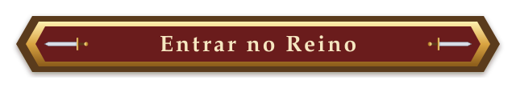</a>

<sub>Sem instalar nada · computador e celular · o jogo salva sozinho</sub>

<br><br>

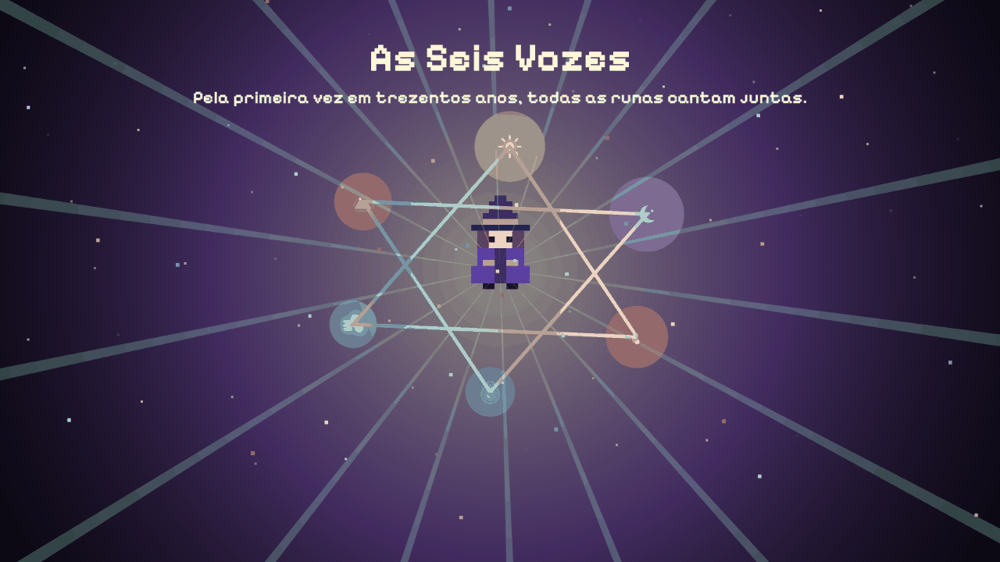

</div>


<a id="escribas"></a>

<div align="center"></div>

<div align="center">

<sub>Universidade São Judas Tadeu · 2026</sub>

<br><br>

<table>
  <tr>
    <td align="center" width="20%">
      <a href="https://github.com/atr3ssa">
        <br>
        <sub><b>Andressa Rabêlo</b></sub>
      </a><br>
      <sub>RA: 823213904</sub>
    </td>
    <td align="center" width="20%">
      <a href="https://github.com/Marzocca99">
        <br>
        <sub><b>Lucas Marzocca</b></sub>
      </a><br>
      <sub>RA: 823116813</sub>
    </td>
    <td align="center" width="20%">
      <a href="https://github.com/Elmarquitoos">
        <br>
        <sub><b>Marcos V. Santos</b></sub>
      </a><br>
      <sub>RA: 82327399</sub>
    </td>
    <td align="center" width="20%">
      <a href="https://github.com/matheushfg">
        <br>
        <sub><b>Matheus H. F.</b></sub>
      </a><br>
      <sub>RA: 823141914</sub>
    </td>
    <td align="center" width="20%">
      <a href="https://github.com/b3ery">
        <br>
        <sub><b>Mylena Soares</b></sub>
      </a><br>
      <sub>RA: 824144075</sub>
    </td>
  </tr>
</table>

</div>

<br>


<a id="sumario"></a>

<div align="center"></div>

[I · A Lenda](#lenda) · [II · Como Jogar](#como-jogar) · [III · História](#historia) · [IV · Simulador](#simulador) · [V · Gentes](#gentes) · [VI · Guardiões](#guardioes) · [VII · Mundo](#mundo) · [VIII · Opções](#opcoes) · [IX · A Forja](#forja)

<br>


<a id="lenda"></a>

<div align="center"></div>

> **Ecos do Arcano** é um **RPG em pixel art** que roda direto no navegador, no computador e no celular. Há trezentos anos, o mago Vesper aprisionou as seis runas para "proteger" a magia e o mundo mergulhou no **Grande Silêncio**. Você é um aprendiz que ainda carrega um eco de uma delas: liberte os Guardiões, descubra o segredo dos irmãos Vesper e Odelia e devolva a Canção Arcana ao mundo. ✦💜

O jogo tem **dois modos**:

| ⚔️ Modo História | 🏡 Simulador de Vida |
|:---|:---|
| Aventura com magia, Guardiões, covis, quebra-cabeças e um final que muda com as suas escolhas. | Uma vida inteira em Cinzaluz, sem magia: trabalho, amor, família, política e crime. |

<br>


<a id="como-jogar"></a>

<div align="center"></div>

**🌐 Online:** [b3ery.github.io/EcosDoArconos](https://b3ery.github.io/EcosDoArconos/) · **💻 No computador:** baixe o repositório e abra o `index.html` no navegador.

```
Setas / WASD     Mover                     I    Bolsa (inventário)
E / Espaço       Interagir e avançar       1–9  Barra de itens (embaixo da tela)
M                Mapa da região / do mundo Q    Missões
Tab              Menu do jogo (Esc: opções) G    Grimório
F                Tela cheia (também no Menu) Z  Zoom
C                Montar no cavalo          R    Decorar a casa
J                Jornada (História) · Jornal (Simulador)
Y                Menu de Ações (Simulador) L    Calendário

Navio:    A/D leme · W/S velas · Espaço âncora (parar) · E atracar
Nadar:    na beira da água, E → Nadar; ande pela água; saia pela margem
Batalha:  1–6 magias · Enter lança · D defende · H habilidades · I itens
Celular:  joystick na metade esquerda · botões A e B · ☰ abre o Menu do jogo · toque e segure numa pessoa
```

> **Menu do jogo:** mochila, mapa, missões, jornal, corações, calendário, casa, cavalo e opções ficam todos num painel só, com ícones e nomes.

> Funciona no computador e no celular (melhor deitado). Na primeira luta, o **Instrutor Kael** ensina tudo passo a passo.

<br>


<a id="historia"></a>

<div align="center"></div>

**Como começa:** você escolhe um **dom** (Lava, Gelo, Raio, Metal, Cristal ou Veneno), que é um pedaço de uma das runas ecoando em você. Enquanto as runas estão presas, o dom é a sua única magia.

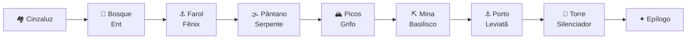

- **Covis dos Guardiões:** cada um tem 5 câmaras de desafio (labirinto escuro, alavancas, placas de luz, guardas e arena), e fica mais difícil a cada runa libertada.
- **Quebra-cabeças e exploração:** 5 pedestais (mosaico, selo, canos, balança e cofre), 15 lugares escondidos e as Provas da Torre.
- **Gente pelo caminho:** encontros nas estradas com escolha de herói ou de vilão. A Odelia, se morrer, vira um fantasma que te segue.
- **Escolhas que pesam:** caminho do herói ou do vilão, o destino do Kael e do diário de Vesper, finais diferentes e **Novo Jogo+**.
- **Batalha:** fraquezas, clima, combos secretos, Guardiões com duas fases e, no fim, **Unir todos os poderes** com quem você ajudou.
- **Missões sem luta (opcionais):** o Ladrão de Tortas, a Canção do Bardo, os Enigmas da Biblioteca e outras. Procure a estrela em cima da cabeça.
- **Dificuldade:** Fácil, Normal e Difícil.

<br>


<a id="simulador"></a>

<div align="center"></div>

| | |
|:---|:---|
| **Começo** | Plebeu, artesão, comerciante, nobre ou realeza. Escolha a casa, pinte, mobilie e faça um segundo andar. |
| **Trabalho** | Mais de 40 profissões. Quem trabalha em prédio fica atrás do balcão no lugar do dono, com fila de clientes, paciência e gorjeta. Cada ofício tem o seu minijogo: forno do padeiro, fole do ferreiro, receita do cozinheiro, troco do balconista, melodia do bardo... No fim do turno, o patrão avalia: bônus, advertência ou demissão. |
| **Guarda Real** | Ordens do dia do General Marcos: patrulhar, caçar procurados e vigiar a masmorra. Quem você prende vai algemado até o calabouço. |
| **Comércio** | Compre um negócio da vila, estoque, preço e atendente. Os aldeões compram todo dia e o livro-caixa mostra receita, Imposto Real, aluguel, perdas e lucro ou prejuízo. |
| **Amor** | Namore qualquer pessoa, **Corações** (o "Tinder" da vila), convide amigos e namorados para encontros pelo inventário, casamento, filhos e herança. |
| **Gente viva** | Moradores com personalidade, que namoram, brigam, casam e morrem de velhice. 14 moradores marcantes com manias e segredos. |
| **A turma** | Exposição dos poemas do Pedro Poeta, Aviário da Princesa Julia, Noites de Arte da Mylena, o General Marcos lendo as sentenças da forca e o Lucas Marzocca com hiperfoco no Matheus, no Marcos e no Luca (as esposas não gostam nada disso). |
| **Poder** | Golpe de Estado, Corte Real, conquista de reinos. Depois do golpe dos Iluministas há eleição: se Luca ou Marzocca vencer, vira **comunismo** (com bandeiras vermelhas no castelo). |
| **Crime** | Roubar, matar, fofoca, calabouço com o Professor L e pena de morte. |
| **Exílio** | No Modo História, o mago exilado é barrado na entrada da vila; de capuz dá para entrar, mas a patrulha te expulsa se te vir. |
| **Vida e morte** | Ano de 15 dias, 30 jeitos de morrer com cena e velório, **convites** de casamento e velório, **Capela Branca e Cemitério**. |
| **Água** | Nadar, banho e roupa lavada no rio; afogar-se ou virar comida de tubarão também são jeitos de morrer |
| **Na tela** | Botões de **Jornal**, **Corações** e **Calendário**, e o **Menu de Ações** (Y) com tudo num lugar só. |

<br>


<a id="gentes"></a>

<div align="center"></div>

### 🍻 A Turma de Cinzaluz: os Alcoólatras Anônimos

Os criadores do jogo viraram personagens, com seus parceiros. Cada um tem **casa, trabalho e rotina** na vila.

<div align="center">

| | | |
|:---:|:---:|:---:|
| 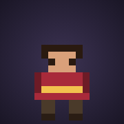<br><b>Lucas Marzocca</b><br><sub>O rolezeiro da Taverna, de olho no Matheus, no Marcos e no Luca</sub> | 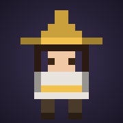<br><b>Duque Matheus</b><br><sub>Fazendeiro do Sítio, melhor amigo do Lucas</sub> | 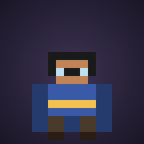<br><b>General Marcos</b><br><sub>Guarda o castelo e treina você (+vida máxima)</sub> |
| <br><b>Andressa</b><br><sub>Dona das bibliotecas. Misteriosa, vende informações</sub> | 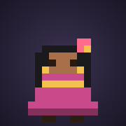<br><b>Princesa Mylena</b><br><sub>Artista do Ateliê de quadros e móveis</sub> | 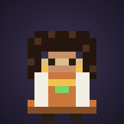<br><b>Júlia Oliveira</b><br><sub>Veterinária da Clínica, dona dos bichos</sub> |

**Os pares**

| | | | | |
|:---:|:---:|:---:|:---:|:---:|
| 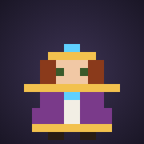<br><b>Duquesa Malu</b><br><sub>Esposa do Matheus</sub> | 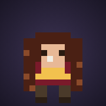<br><b>Princesa Julia</b><br><sub>Esposa do Marcos</sub> | 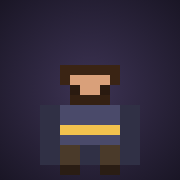<br><b>Pedro, o Poeta</b><br><sub>Marido da Andressa</sub> | 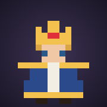<br><b>Príncipe Pedro Max</b><br><sub>Marido da Mylena</sub> | 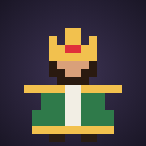<br><b>Rei Vini do Sul</b><br><sub>Marido da Júlia</sub> |

**E o Luca**

| | |
|:---:|:---|
| 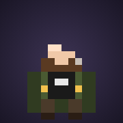<br><b>Luca, o Maluco</b> | Careca, barbudo e fora da caixinha: conversa com quem está jogando. Com o Lucas, lidera os **Iluministas**, contra a monarquia. |

</div>

<details>
<summary><b>🧙 Personagens principais</b></summary>

<br>

<div align="center">

| | | | |
|:---:|:---:|:---:|:---:|
| 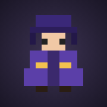<br><b>Arquimaga Odelia</b><br><sub>Mentora do aprendiz e irmã de Vesper · Cinzaluz</sub> | 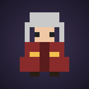<br><b>Instrutor Kael</b><br><sub>Ensina a lutar com runas · Cinzaluz</sub> | 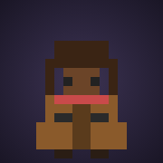<br><b>Bruno, o Alquimista</b><br><sub>Poções e remédios · Cinzaluz</sub> | 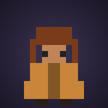<br><b>Rosa, a Quitandeira</b><br><sub>Comida e bebida · Cinzaluz</sub> |
| 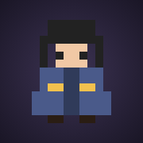<br><b>Doran, o Artesão</b><br><sub>Cajados mágicos · Cinzaluz</sub> | 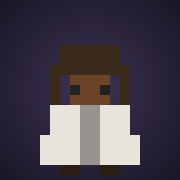<br><b>Curandeira Maíra</b><br><sub>Cura e cuidados · Cinzaluz</sub> | 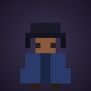<br><b>Capitão Bento</b><br><sub>Velho marinheiro · Porto Brisamar</sub> | 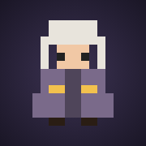<br><b>Anciã Berta</b><br><sub>Conhece a história dos anões · Pedravale</sub> |
| 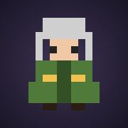<br><b>Druida Errante</b><br><sub>Dicas sobre o Ent · Bosque Murmurante</sub> | 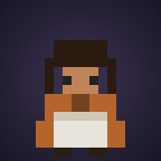<br><b>Monge da Montanha</b><br><sub>Dicas sobre o Grifo · Picos Uivantes</sub> | 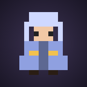<br><b>Professora Selene</b><br><sub>Antiga professora · Academia Arcana</sub> | 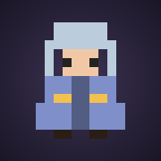<br><b>Espírito de um Aprendiz</b><br><sub>Dicas sobre o Silenciador · Torre do Silêncio</sub> |
| 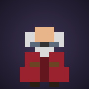<br><b>Professor Bruno Honda</b><br><sub>Historiador de runas: decifra o diário de Vesper · Praça</sub> | <b>Professor L</b><br><sub>O prisioneiro insuportável do calabouço. Ninguém sabe o nome dele</sub> | <b>Velha Juta</b><br><sub>Guarda as memórias do Pântano</sub> | <b>Eco do Bibliotecário</b><br><sub>Lê os livros de Vesper · Torre</sub> |

</div>

</details>

<details>
<summary><b>👑 Família Real</b></summary>

<br>

<div align="center">

| | | | |
|:---:|:---:|:---:|:---:|
| 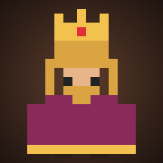<br><b>Rainha Aurélia</b><br><sub>Governa Aurélia do Castelo de Cinzaluz</sub> | <br><b>Príncipe Pedro Max</b><br><sub>Filho da Rainha. Ciumento: ninguém mexe com a Mylena</sub> | <br><b>Princesa Mylena</b><br><sub>Artista do Ateliê, esposa do Pedro Max</sub> | 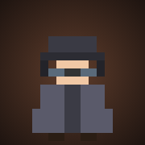<br><b>Guarda Real</b><br><sub>Protege o castelo e a passeata</sub> |

</div>

> A cada 5 dias a família real faz uma passeata pela vila. Os outros reinos têm o **Príncipe-Almirante Tarso** (Marés) e o **Rei-Anão Durgan** (Pedravale).

</details>

<br>


<a id="guardioes"></a>

<div align="center"></div>

<div align="center">

| | Chefe | Onde |
|:---:|:---|:---|
| 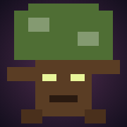 | **Ent Silenciado** | 🌲 Bosque Murmurante |
| 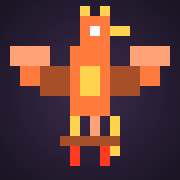 | **Fênix do Farol** | ⚓ Farol de Brisamar (à noite) |
| 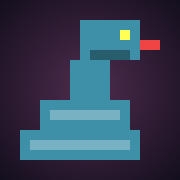 | **Serpente de Névoa** | 🌫️ Pântano das Brumas |
| 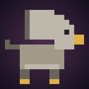 | **Grifo de Pedra** | 🏔️ Picos Uivantes |
| 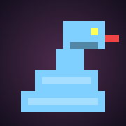 | **Basilisco de Cristal** | ⛏️ Mina de Cristal |
| 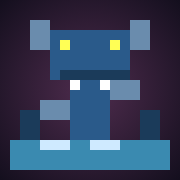 | **Leviatã do Cais** | ⚓ Porto Brisamar |
| 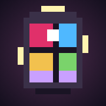 | **Espírito do Vitral** (secreto) | ⛪ Templo da Luz |
|  | **Diretor Espectral** | 📚 Academia Arcana |
| 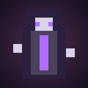 | **O Silenciador** (final) | 🗼 Torre do Silêncio |

</div>

Cada Guardião guarda uma das seis runas: 🔥 Chama, 💧 Água, 🌪️ Ar, ⛰️ Terra, ☀️ Luz e 🌙 Sombra. **27 feitiços** de 1 ou 2 runas e **8 combos secretos**. Acertar a fraqueza dá quase o dobro de dano, e cada feitiço sobe de nível com o uso.

<br>


<a id="mundo"></a>

<div align="center"></div>

| Lugar | O que tem |
|:---|:---|
| 🏘️ **Cinzaluz** | Praça, mercado, 20+ lojas com interior, castelo, templo, taverna, calabouço, Bairro das Flores e o Alto do Descanso (Capela Branca e Cemitério) |
| ⚓ **Porto Brisamar** | Farol, cais e o Palácio das Marés numa ilha |
| ⛏️ **Pedravale** | Forja anã, Mina de Cristal e a Fortaleza |
| 🌲 **Bosque** · 🌫️ **Pântano** · 🏔️ **Picos** | Os Guardiões, a Cripta dos Ecos e a Velha Juta |
| 📚 **Academia Arcana** · 🗼 **Torre do Silêncio** | Tomos de feitiços e o Silenciador |
| 🌍 **Além-mar** | 10 países com 5 reinos cada, de navio: roupas, clima, sotaque e leis de cada terra |
| 🌳 **Florestas** | 3 matas por cidade (rio, mata fechada e vale do lago), com os bichos, frutas e plantas da terra. Caçar demais acaba com eles. Tem cachoeira, montanha nevada e vulcão |
| 🌳 **Parques** | Em toda cidade, vila e reino: árvores, caminho em anel e parquinho (balanço, escorregador, gangorra, caixa de areia, trepa-trepa e gira-gira) com crianças brincando de dia |
| 💧 **Rios e lagos** | Pescar, beber, lavar roupa, tomar banho e **nadar de verdade**: fôlego, risco de afogamento e **tubarões** no fundo do mar |
| 🌊 **O mar** | Ondas que vêm do fundo e quebram na praia, espuma que vai e volta, e o mar escurece quando fica fundo |
| ⛵ **Navios** | Velas, leme e âncora; atraque nos países além-mar e desembarque nos portos |

<div align="center">

| | | |
|:---:|:---:|:---:|
| 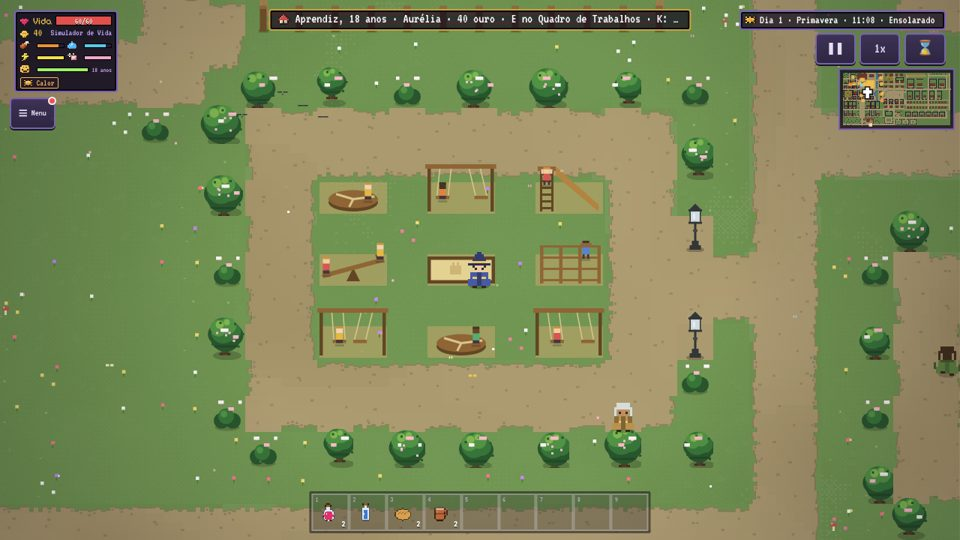<br><sub>Parque com parquinho</sub> | 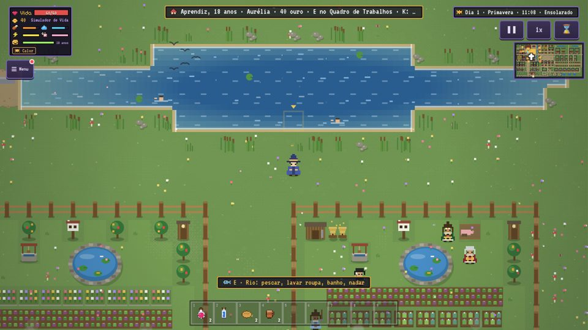<br><sub>Lago do rio</sub> | 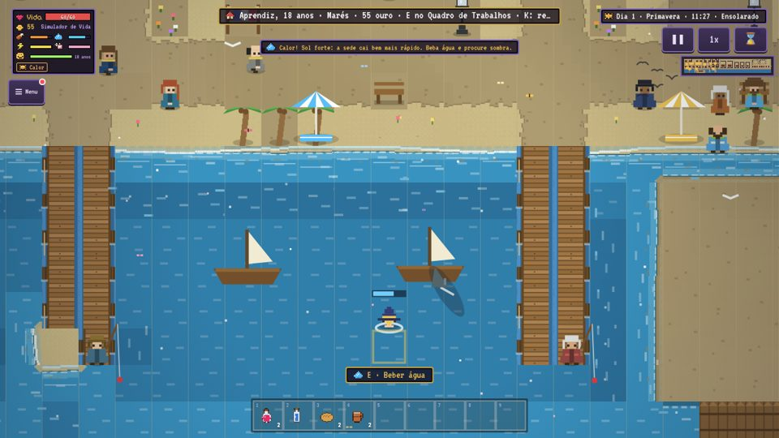<br><sub>Nadando no mar (e a barbatana...)</sub> |
| 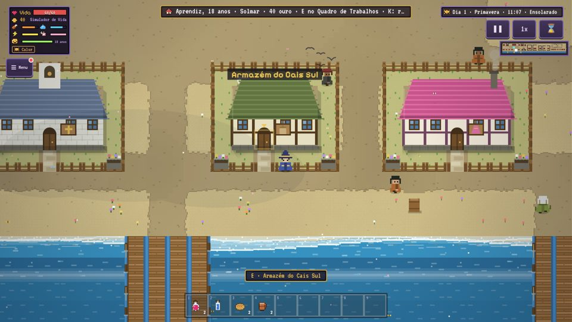<br><sub>Ondas quebrando em Solmar</sub> | 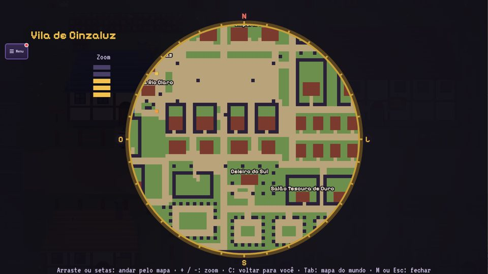<br><sub>Mapa redondo, como uma bússola</sub> | |

</div>

**Cidades em lotes, como no The Sims:** bairros de ricos, classe média e pobres; cada casa com jardim na frente e quintal cercado nos fundos (porta dos fundos na sua casa), e cada loja com o seu lote.

<br>


<a id="opcoes"></a>

<div align="center"></div>

- **Acessibilidade:** tamanho da letra, tremores e flashes, cenas que esperam o seu toque.
- **Acontecimentos:** desligar os ataques de monstros (História), o golpe automático (Simulador) e o **sangue**.
- **Conteúdo:** **Modo +18** opcional, só para maiores (o jogo pede o ano de nascimento): palavrões, noite a dois numa cena discreta, trisal, e os riscos do casual. O sangue só aparece a partir dos 16 anos.
- **Tutoriais:** dicas curtas na primeira vez de cada mecânica, que dá para rever no Menu.
- **Jogo salvo:** baixar ou copiar para levar a outro aparelho.

<br>


<a id="forja"></a>

<div align="center"></div>

HTML5, CSS3 e JavaScript puro, sem dependências. Tudo é desenhado pixel a pixel no `<canvas>` e a música é criada na hora com o Web Audio API.

```
EcosDoArconos/
├── index.html        a página e a ORDEM dos scripts
├── css/style.css     o visual de todas as telas
├── js/
│   ├── nucleo/       dados, estado, sons, sprites, laço principal, teclado
│   ├── mundo/        mapas, vila, reinos, casas, castelos, floresta, clima
│   ├── pessoas/      diálogos, família, turma, moradores
│   ├── interface/    telas, menus, opções, criador, celular, bolsa
│   ├── historia/     história, covis, batalha, saga
│   └── vida/         Simulador: moradores, poder, realeza, crime, família
├── assets/           retratos e a imagem de capa deste README
├── tests/smoke.js    teste automático (npm test)
└── tools/            check.js (npm run check) e build.js (um arquivo só)
```

- `npm run check` confere a sintaxe e se todo arquivo está no `index.html`; `npm test` abre o jogo e passa pelas telas dos dois modos.
- Cada arquivo trata de um assunto e explica no cabeçalho o que faz e quais funções de outros arquivos ele modifica. A ordem de carregamento fica no `index.html`.
- **Truques para testar e apresentar:** no computador, segure **Ctrl** e digite **E C O**; no celular, toque 5 vezes no título do **Menu do jogo**. Aparece o painel **TESTES** (ou **F9**): ir a qualquer lugar, mudar hora e clima, abrir minigames, pular etapas da história. Também dá para abrir `dev.html`.

<br>


<div align="center">

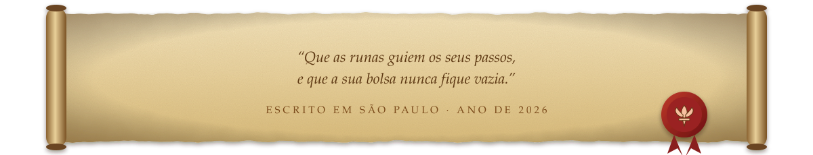

</div>
